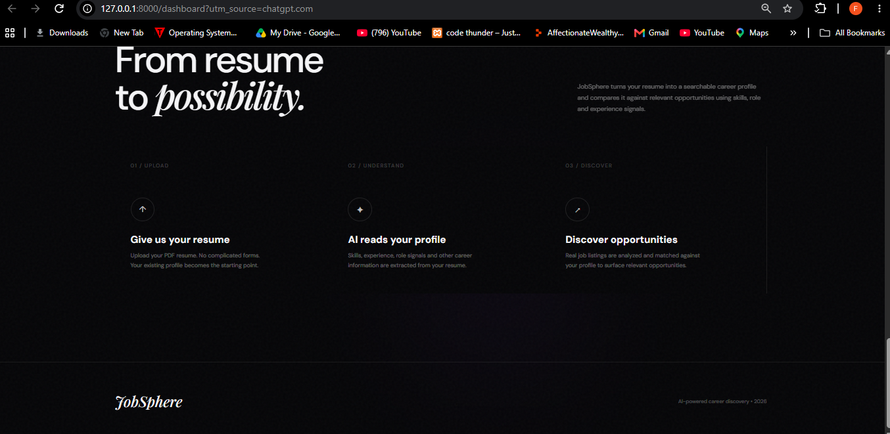
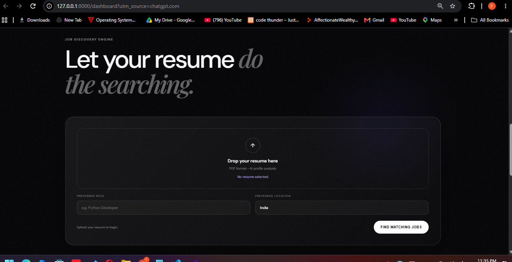
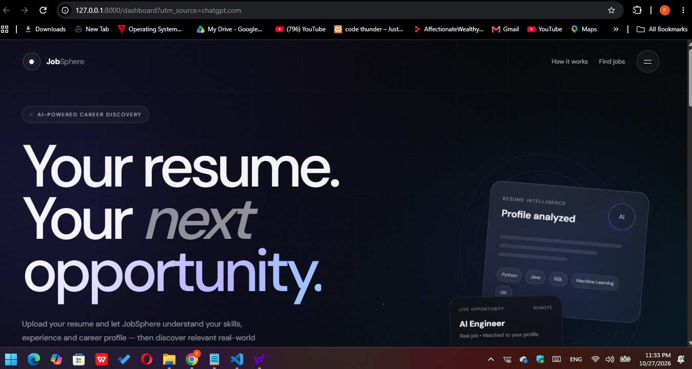

# JobSphere — AI Job Search & Matching Agent

JobSphere is a Python and FastAPI-based project designed to help job seekers discover relevant opportunities by comparing job listings with their skills and career preferences.

The project includes a web dashboard, job-source integrations, job-matching logic, and experimental browser-based application assistance.
## Dashboard Preview

### 1. Homepage

The JobSphere homepage provides an overview of the AI-powered job search and matching platform.



### 2. Resume Upload and Job Search

This section shows the resume upload interface and job search form used to explore relevant job opportunities.



### 3. How It Works

This section presents the workflow and supporting information displayed on the JobSphere website.




## Key Features

- **Job Discovery:** Retrieve job listings from configured job sources.
- **Job Matching:** Compare job listings with profile details and relevant skills.
- **Web Dashboard:** Access the project through a browser-based interface.
- **Resume Workflow:** Support for resume upload and profile analysis, depending on the implemented functionality.
- **Application Assistance:** Experimental tools for application-page analysis and form filling.

## Technology Stack

- Python
- FastAPI
- Uvicorn
- HTML, CSS, and JavaScript
- Requests
- pypdf
- Playwright

## Project Structure

```text
JobSphere/
├── backend/
│   ├── agent/
│   ├── frontend/
│   ├── job_sources/
│   ├── models/
│   ├── main.py
│   └── requirements.txt
├── docs/
│   └── screenshots/
├── .gitignore
└── README.md
```

## Getting Started

### Prerequisites

- Python
- Git
- A modern web browser

### 1. Clone the Repository

```bash
git clone https://github.com/farhan-geeky7/JobSphere-AI-Job-Search-Agent.git
cd JobSphere-AI-Job-Search-Agent
```

### 2. Open the Backend Directory

```bash
cd backend
```

### 3. Create a Virtual Environment

On Windows PowerShell:

```powershell
py -m venv venv
```

Activate the environment:

```powershell
.\venv\Scripts\Activate.ps1
```

If PowerShell blocks activation, use the environment's Python executable directly.

### 4. Install Dependencies

```bash
python -m pip install --upgrade pip
python -m pip install -r requirements.txt
```

### 5. Install the Playwright Browser

If browser automation is required, install Chromium:

```bash
python -m playwright install chromium
```

### 6. Start the Backend

Run this command from the `backend` directory:

```bash
python -m uvicorn main:app --reload
```

Open the dashboard:

http://127.0.0.1:8000/dashboard

FastAPI documentation:

http://127.0.0.1:8000/docs

## How It Works

1. Start the FastAPI backend.
2. Open the dashboard in your browser.
3. Enter job preferences and upload a resume where supported.
4. Retrieve job listings from configured sources.
5. Review matching results and open the original job postings.
6. Review application details before submitting an application.

Available functionality depends on the current implementation and supported job sources.

## Privacy and Security

- Do not commit personal resumes, uploaded documents, passwords, API keys, or secret environment files to GitHub.
- Keep private user data out of version control.
- Verify job postings on the original website before sharing personal information.
- Follow the terms and automation policies of each job platform.

## Current Project Status

JobSphere is a work in progress. Job-source integrations, matching quality, resume handling, and browser automation require testing. Experimental application assistance may not work on every website.

## Contributing

Suggestions, bug reports, and contributions are welcome. Please describe issues clearly and include steps to reproduce them.

## Author

**Farhan Alam**

GitHub: [@farhan-geeky7](https://github.com/farhan-geeky7)

## License

No license has been specified for this repository yet. Add a license before permitting others to reuse or redistribute the project under specific terms.
